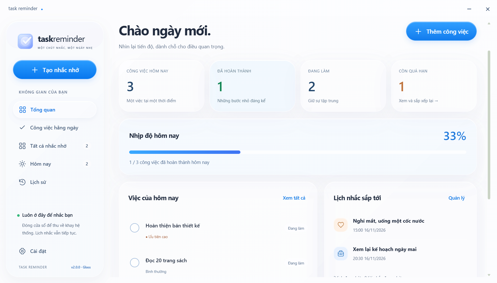
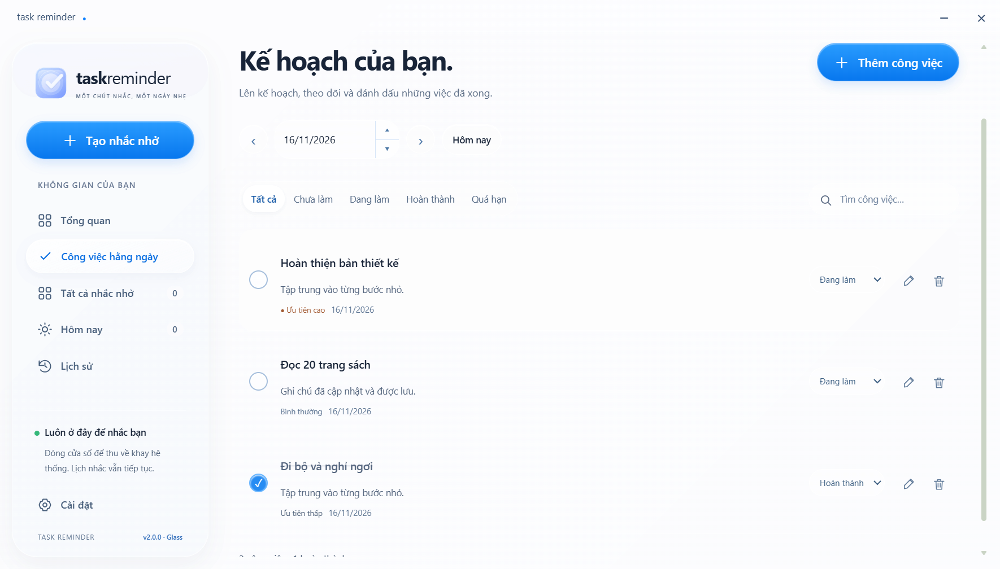
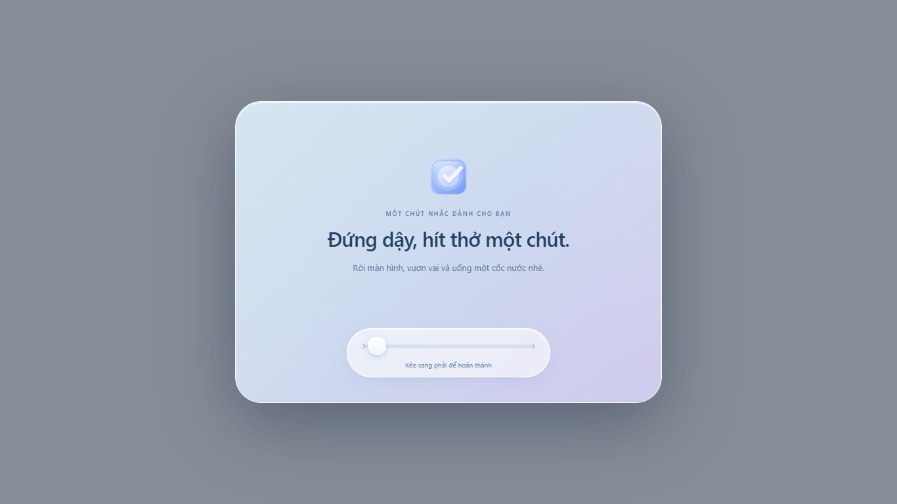

<div align="center">

# Task Reminder

**Một chút nhắc, một ngày nhẹ.**

Ứng dụng Windows giúp bạn quản lý công việc hằng ngày, theo dõi tiến độ và nhận lời nhắc đúng lúc — ngay trên máy tính của mình.


</div>



## Liquid Glass 2.0

Toàn bộ dashboard, công việc, lịch nhắc, biểu mẫu, cài đặt và popup dùng giao diện kính mới. Trên Windows 11 22H2 trở lên, Acrylic làm mờ **desktop thật phía sau cửa sổ**, kết hợp thư viện [@tomagranate/liquid-glass](https://github.com/tomagranate/liquid-glass) cho viền và khúc xạ. Có thanh **Độ trong của lớp kính** (mặc định 72%) trong Cài đặt; vùng nhập liệu giữ nền rõ để dễ đọc. Máy không hỗ trợ Acrylic dùng nền màu đơn. Không dùng wallpaper.

Icon checkbox kính xanh dương–trắng có nhiều kích thước cho Windows. Hiệu ứng ngắn, tránh blur chồng; khúc xạ giới hạn ở viền, cửa sổ ẩn ngừng cập nhật UI và kiểm tra lịch không sao chép dữ liệu khi chưa đến hạn.

Bản này sửa lỗi nâng cấp từ portable: bộ cài cũ chỉ tìm app trong thư mục cài, để bản portable ở nơi khác giữ khóa một phiên. Bộ cài mới phát hiện app trong phiên Windows hiện tại, hỏi đóng bản cũ và sao lưu dữ liệu trước khi nâng cấp. Cài đặt hiển thị phiên bản, đường dẫn chương trình và mã build; khi một bản khác giữ khóa, app thông báo thay vì âm thầm mở lại giao diện cũ.

## Bạn có thể làm gì?

- **Nhìn lại ngày của mình:** dashboard tổng hợp công việc hôm nay, việc đã hoàn thành, đang làm, quá hạn và tiến độ trong 7 ngày.
- **Lên kế hoạch từng ngày:** thêm, sửa, xóa công việc; đặt mức ưu tiên, ghi chú và chuyển trạng thái. Có tìm kiếm, lọc và chuyển việc quá hạn sang hôm nay.
- **Nhắc đúng lịch:** chọn một lần, mỗi ngày hoặc các thứ trong tuần. Nhập trực tiếp ngày và giờ, dùng nút tăng giảm để điều chỉnh.
- **Nhận nhắc nhở ở giữa màn hình:** popup hiển thị ngay, làm tối phần nền để bạn tập trung; kéo hết thanh để tắt, thả sớm để quay lại.
- **Giữ nhịp khi đóng cửa sổ:** app thu về khay hệ thống. Tùy chọn Windows Task Scheduler giúp mở lại app khi đến lịch ngay cả khi đã thoát hẳn.
- **Tiếp tục sau khi mở máy:** các lịch đã lỡ được kiểm tra và nhắc bù khi app chạy lại; có thể kiểm tra sau đăng nhập bằng lịch Windows.
- **Giữ dữ liệu riêng trên máy:** không cần tài khoản, không đồng bộ công việc lên máy chủ.

Lịch nhắc **một lần** tự xóa sau khi người dùng tắt popup, nhưng vẫn giữ lịch sử. Lịch mỗi ngày/tuần tiếp tục sang lần kế tiếp. Công việc đã hoàn thành vẫn được giữ để tổng hợp tiến độ.

## Giao diện

Giao diện tiếng Việt với kính trong, nền desktop mờ, nút bo tròn và chuyển động nhẹ. Có tùy chọn giảm chuyển động và chỉnh độ trong của kính.

### Quản lý công việc



### Popup nhắc nhở



Ảnh sử dụng dữ liệu demo. Công việc theo ngày và lịch nhắc được quản lý riêng: tạo lịch nhắc khi bạn muốn một công việc có popup báo giờ.

## Cài đặt và sử dụng

**[Tải bộ cài Task Reminder 2.0.0 cho Windows x64](https://github.com/MinhQang/Task_reminder/releases/download/v2.0.0/Task-Reminder-Setup-2.0.0.exe)**

[Xem bản phát hành và mã SHA-256](https://github.com/MinhQang/Task_reminder/releases/tag/v2.0.0). Chỉ cần tải tệp Setup.exe để cài đặt.

Bạn cũng có thể tự tạo bộ cài từ mã nguồn bằng hướng dẫn bên dưới. Kết quả là `dist/Task-Reminder-Setup-2.0.0.exe`, chứa đầy đủ runtime Electron; máy sử dụng **không cần cài Node.js, Python hay VS Code**.

1. Chạy bộ cài và chọn thư mục cài đặt cho tài khoản Windows hiện tại.
2. Mở **Task Reminder** từ Desktop hoặc Start Menu.
3. Thêm công việc ở **Công việc hằng ngày**, hoặc tạo một **nhắc nhở** để nhận popup đúng giờ.
4. Đóng cửa sổ để thu app về khay; muốn thoát hẳn, dùng menu trên biểu tượng khay hệ thống.

Nếu đang dùng bản cũ/portable, hãy thoát bản đó ở khay hệ thống trước khi chuyển sang bản mới.

> Máy tắt hoặc chưa đăng nhập không thể hiển thị popup. App kiểm tra nhắc bù sau khi chạy lại; app không chủ động đánh thức máy ngủ. Việc đăng ký lịch và chạy nền còn phụ thuộc quyền/chính sách Windows. Bản hiện tại chưa ký số.

## Dữ liệu của bạn nằm ở đâu?

```text
%APPDATA%\task-reminder\reminders.json
```

Mỗi tài khoản Windows có dữ liệu riêng. Bộ cài không mang theo dữ liệu của người phát triển. Để sao lưu, thoát app rồi sao chép tệp JSON; gỡ cài đặt giữ lại dữ liệu công việc và dọn đăng ký nhắc nền/khởi động của app.

## Chạy từ mã nguồn

Cần Git và Node.js/npm trên máy phát triển. Chạy các lệnh sau trong PowerShell:

```powershell
git clone https://github.com/MinhQang/Task_reminder.git
cd Task_reminder
npm.cmd ci
npm.cmd start
```

### Tạo bộ cài

```powershell
npm.cmd run build
```

Bộ cài nằm trong `dist/`. Lần build đầu cần mạng để tải các công cụ đóng gói. Máy người dùng cuối có thể cài và sử dụng offline.

### Kiểm thử

```powershell
npm.cmd test
npm.cmd run test:browser
npm.cmd run test:ui
npm.cmd run test:features
```

Dự án có 19 kiểm thử đơn vị, kiểm thử giao diện Electron và kiểm tra runtime trích từ bộ cài. Kiểm thử Chrome dùng Chrome cài trên máy; kiểm tra Windows Task Scheduler tạo lịch thử riêng rồi dọn sau khi hoàn tất.

Đã kiểm tra trên máy Windows phát triển, gồm chạy payload bộ cài ở đường dẫn khác có dấu tiếng Việt với PATH chỉ chứa Windows. Chưa kiểm tra trên máy vật lý thứ hai. Xem [hướng dẫn phát triển và các kiểm tra bổ sung](docs/DEVELOPMENT.md).

## Kiến trúc

```text
src/
├── core/                 # Lưu dữ liệu và giao dịch JSON
├── features/
│   ├── daily/            # Công việc theo ngày
│   ├── dashboard/        # Tính toán thông tin tổng quan
│   └── reminders/        # Quản lý nhắc nhở
├── platform/             # Đăng ký giao tiếp IPC
├── ui/
│   ├── modules/          # UI theo tính năng và hiệu ứng
│   └── popup.*           # Popup và thao tác kéo
├── main.js               # Vòng đời Electron, cửa sổ, tray
├── preload.js            # API giới hạn cho giao diện
├── scheduler.js          # Lịch lặp, nhắc bù, hẹn lại
└── windows-scheduler.js  # Tích hợp Windows Task Scheduler
```

## Góp ý

Bạn có thể [báo lỗi hoặc đề xuất tính năng](https://github.com/MinhQang/Task_reminder/issues). Khi báo lỗi, hãy mô tả bước thực hiện, kết quả mong muốn và phiên bản Windows; tránh đính kèm tệp dữ liệu cá nhân.

## Thư viện và tham khảo thiết kế

- [Liquid Glass — Tomagranate](https://github.com/tomagranate/liquid-glass), MIT, phiên bản 0.0.2; được đóng gói cục bộ để dùng offline.
- [Electron Acrylic](https://www.electronjs.org/docs/latest/api/browser-window#winsetbackgroundmaterialmaterial-windows) cho vật liệu nền Windows.

## Tham khảo thiết kế

- [UI UX Pro Max](https://github.com/nextlevelbuilder/ui-ux-pro-max-skill)
- [Material Design 3 UI](https://github.com/skydashnet/material-design-3-ui-skill)
- [Taste Skill](https://github.com/leonxlnx/taste-skill)

Các repo tham khảo và dữ liệu kiểm thử không được đóng gói cùng ứng dụng.
